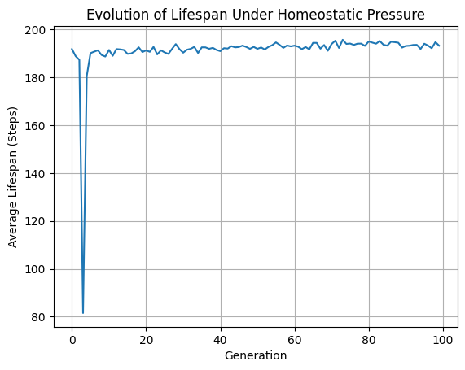

# Project Archean: Spatial population model under metabolic constraints

## Abstract
This historical artificial-life model investigates selection on movement controllers under a fixed metabolic budget, reproduction with mutation and a population cap. Agents receive exact offsets to a nondepleting feeding zone and current energy. There is no task-specific accuracy reward; resource uptake, mortality, replication and cap-based retention define the selection environment.

## Theoretical Foundations
1. **Self-maintenance and control:** The controller maps exact vent offsets and internal energy to movement. It does not learn a predictive model during a lifetime.
2. **Heritable controller parameters:** Offspring inherit six movement weights with mutation. Epoch-boundary weight retention is distinct from acquired lifetime memory.

## Simulation Mechanics
* **Metabolic Cost:** Every simulation step costs `0.5` energy units.
* **Homeostasis:** If internal energy drops to `0`, the agent is removed from the population (death).
* **Mitosis:** If an agent reaches `200` units of energy, it reproduces, passing mutated controller weights to its offspring.
* **Carrying Capacity:** The population is capped at 500 agents, retaining those with the highest energy whenever the cap is exceeded.

## Experimental Progression & Tuning

* **v1.0 — Initial extinction:** Retrospective account of extinction at generation 0 under high metabolic cost; original run records unavailable.
* **v1.1 — Unbounded population growth:** Retrospective account of more than 200,000 agents by generation 1 after tuning; original run records unavailable.
* **v1.2 — Population cap:** The surviving implementation retains the 500 highest-energy agents when the cap is exceeded. This is an imposed retention rule, not evidence of optimised navigation.

## Recorded outcome and limitations
The historical plot measures mean current age among surviving agents at epoch boundaries over a run of up to 100 epochs. It does not directly measure navigation, predictive modelling or within-lifetime learning. The original run was not seeded for exact replication.

*Simulation built in Python/NumPy.*
