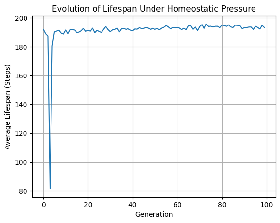

# Project Archean: Emergent Chemotaxis via Homeostatic Constraints

## Abstract
This repository implements a bottom-up, artificial life (ALife) framework testing an inversion of the current AI paradigm. While modern deep learning models focus on top-down cognitive tasks (text tokens, static optimization datasets), **Project Archean** models intelligence as an emergent byproduct of autopoiesis and thermodynamic self-maintenance. 

Agents (Artificial Cells) are embedded in a continuous grid environment containing a localized feeding zone. They receive no explicit task-reward labels. Instead, they operate under strict metabolic costs where survival and replication are the sole evolutionary drivers.

## Theoretical Foundations
1. **The Free Energy Principle & Autopoiesis:** Self-maintenance motivates the model. The implemented controller maps exact vent offsets and current energy directly to movement. Learning a predictive model is a future research question.
2. **Lineage Memory ("The Soul"):** Offspring inherit six movement weights with mutation. The baseline experiment saves these weights and founder IDs at epoch boundaries.

## Simulation Mechanics
* **Metabolic Cost:** Every simulation step costs `0.5` energy units.
* **Homeostasis:** If internal energy drops to `0`, the agent is permanently pruned from the simulation (death).
* **Mitosis:** If an agent reaches `200` units of energy, it undergoes cellular division, passing mutated neural weights down to its lineage.
* **Carrying Capacity:** The environment supports a maximum of 500 agents, retaining the highest-energy cells whenever the cap is exceeded.

## Experimental Progression & Tuning

* **v1.0 - The Great Filter:** Initialized with harsh metabolic costs. Result: **Extinction at Gen 0.** The baseline entropy outpaced random exploration. 
* **v1.1 - The Cambrian Explosion:** Relaxed metabolic decay and expanded vent radius. Result: **Runaway Population.** The population exploded to 200,000+ agents by Gen 1. The replication mechanism succeeded, but the lack of resource limits removed evolutionary pressure.
* **v1.2 - The Evolutionary Bottleneck:** Implemented a strict carrying capacity (500 agents). Result: **Stabilized Evolution.** The environment now prunes the weakest agents dynamically. The navigation experiment measures how this selection changes the distribution of controller performance.

## Results: Generational Adaptation
The historical plot tracks average age among surviving cells at each epoch boundary. For the frozen-controller vent-reaching experiment and the planned local-sensing and inherited-memory studies, see [the research programme](RESEARCH.md).

*Simulation built in Python/NumPy.*

### v2.1 local-sensing experiment

[Protocol and six-seed results](LOCAL_SENSING.md) for navigation using four local concentration probes, paired shuffled and zero-cue controls, and a separately trained exact-direction reference.
