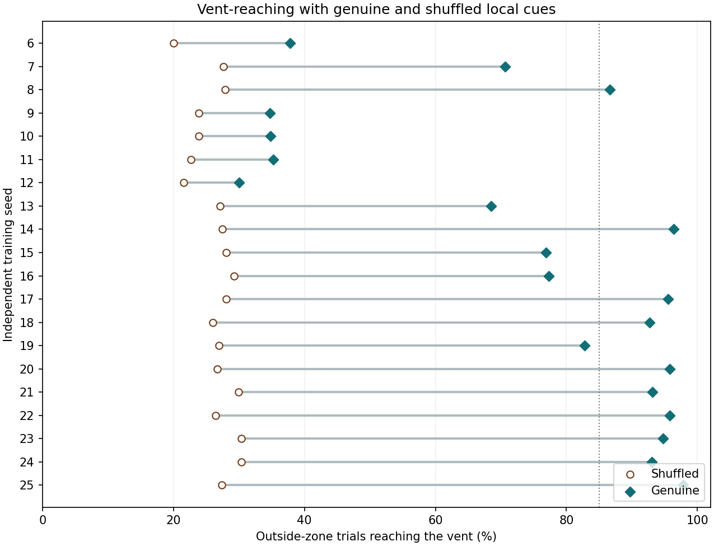

# Local-sensing replication on seeds 6–25

The v2.1.0 pilot used seeds 0–5. This follow-up fixed the twenty fresh training seeds, the paired genuine-minus-shuffled outcome and the strict 85% threshold before running. The threshold was chosen after examining the pilot. All percentages below refer to the fresh cohort alone.

At epoch five, genuine sensing averaged 74.5% reach and shuffled sensing averaged 26.6%. The median paired difference was 57.2 percentage points. Genuine cues outperformed shuffling in 20 of 20 seeds. 10 of 20 populations exceeded 85% with genuine cues. The zero-cue mean was 20.0%, and the separately evolved exact-direction arm averaged 83.4%.

All 20 local and 20 exact populations reached epoch five. Each row summarises 32 sampled frozen controllers on the same 96 outside-zone starts. The independent unit is one training seed. This experiment measures repeatability over training populations for the same noiseless field, four test vents and fixed trial/shuffle schedule.



| Seed | Genuine (%) | Shuffled (%) | Difference (pp) |
|---|---:|---:|---:|
| 6 | 37.83 | 20.02 | +17.81 |
| 7 | 70.61 | 27.64 | +42.97 |
| 8 | 86.59 | 27.90 | +58.69 |
| 9 | 34.73 | 23.86 | +10.87 |
| 10 | 34.83 | 23.86 | +10.97 |
| 11 | 35.22 | 22.69 | +12.53 |
| 12 | 30.05 | 21.55 | +8.50 |
| 13 | 68.52 | 27.12 | +41.41 |
| 14 | 96.35 | 27.51 | +68.85 |
| 15 | 76.92 | 28.06 | +48.86 |
| 16 | 77.31 | 29.26 | +48.05 |
| 17 | 95.54 | 28.06 | +67.48 |
| 18 | 92.68 | 26.01 | +66.67 |
| 19 | 82.75 | 26.95 | +55.79 |
| 20 | 95.77 | 26.69 | +69.08 |
| 21 | 93.13 | 29.92 | +63.22 |
| 22 | 95.77 | 26.46 | +69.30 |
| 23 | 94.79 | 30.37 | +64.42 |
| 24 | 93.00 | 30.34 | +62.66 |
| 25 | 97.82 | 27.34 | +70.48 |

## Reproduction

Use the [v2.1 experimental design](LOCAL_SENSING.md). Run the following from the repository root in a shell with an unused output location.

```sh
for seed in $(seq 6 25); do
  OPENBLAS_NUM_THREADS=1 python local_sensing.py "my_replication/seed_$seed" --seeds "$seed" || exit 1
done
```

The archived seed directories contain paired trial geometries, founder and final controller samples, raw first-contact steps and per-condition reach rates. The aggregate CSV retains full precision. All 160 condition summaries were checked against their raw hit matrices and all geometry arrays against the pilot. Local-sensing unit tests passed.
