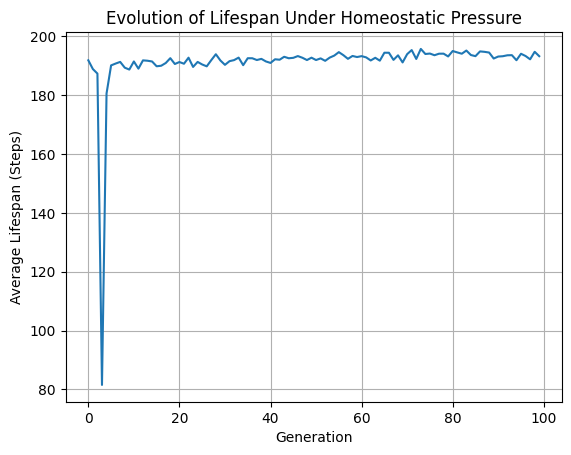

# Project Archean: Spatial population model under metabolic constraints

## Abstract
This historical artificial-life model investigates selection on movement controllers under a fixed metabolic budget, reproduction with mutation and a population cap. Agents receive exact offsets to a nondepleting feeding zone and current energy. There is no task-specific accuracy reward; resource uptake, mortality, replication and cap-based retention define the selection environment.

## Theoretical Foundations
1. **Self-maintenance and control:** The controller maps exact vent offsets and internal energy to movement. It does not learn a predictive model during a lifetime.
2. **Heritable controller parameters:** Offspring inherit six movement weights with mutation. Epoch-boundary weight retention is distinct from acquired lifetime memory.

## Simulation Mechanics
* **Metabolic Cost:** Every simulation step costs `0.5` energy units.
* **Homeostasis:** If internal energy drops to `0`, the agent is removed from the population (death).
* **Mitosis:** If an agent reaches `200` units of energy, it reproduces, passing mutated controller weights to its offspring.
* **Carrying Capacity:** The environment supports a maximum of 500 agents, retaining the highest-energy cells whenever the cap is exceeded.

## Experimental Progression & Tuning

* **v1.0 — Initial extinction:** Retrospective account of extinction at generation 0 under high metabolic cost; original run records unavailable.
* **v1.1 — Unbounded population growth:** Retrospective account of more than 200,000 agents by generation 1 after tuning; original run records unavailable.
* **v1.2 — Population cap:** The surviving implementation retains the 500 highest-energy agents when the cap is exceeded. This is an imposed retention rule, not evidence of optimised navigation.

## Recorded outcome and limitations
The historical plot tracks average age among surviving cells at each epoch boundary. For the frozen-controller vent-reaching experiment and the planned local-sensing and inherited-memory studies, see [the research programme](RESEARCH.md).

*Simulation built in Python/NumPy.*

### v2.1 local-sensing experiment

[Protocol and six-seed results](LOCAL_SENSING.md) for navigation using four local concentration probes, paired shuffled and zero-cue controls, and a separately trained exact-direction reference.

[Replication on 20 fresh training seeds](LOCAL_SENSING_REPLICATION.md) includes per-seed paired differences, raw trials and the fixed 85% success threshold.

### v2.2 inherited experience and intervention

[Protocol, controls, and forty-seed results](INHERITANCE.md) for the companion experiments on inherited cue memories, action-dependent help, and internal action-cost estimates. Run `python inherited_experience.py new_results` to reproduce them.
