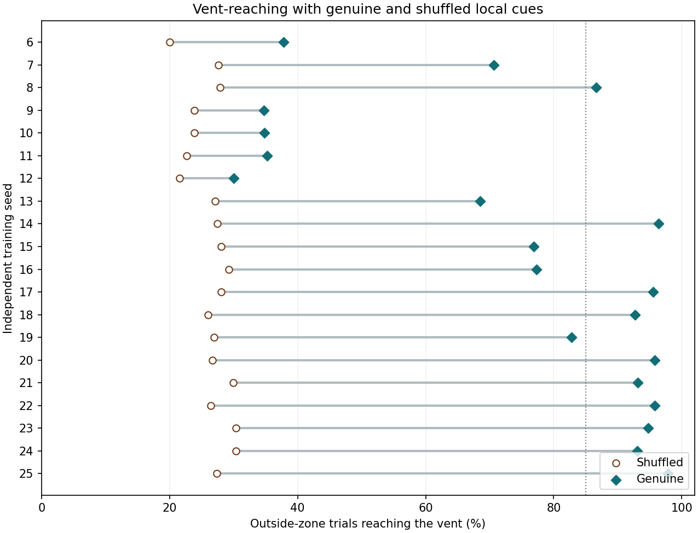

# Project Archean
### A research programme in artificial life, survival-driven adaptation and inherited experience

**Research question:** Under what conditions can measurable adaptive capabilities emerge from self-maintenance and reproduction, and when does inheriting acquired information help or harm an offspring?

Project Archean explores this question through Python/NumPy simulations. It starts with a spatial population under metabolic constraints, progresses to controlled navigation and local-sensing experiments, then isolates the effects of inherited experience in a separate decision-making model. The broader hypothesis that selection may favour useful cognitive mechanisms is a research direction, not an established conclusion.

## Research progression

| Stage | Question and principal finding | Evidence |
| --- | --- | --- |
| [01 — Original model](01-original-model/) | Early tuning explored extinction, uncontrolled replication and a finite population bottleneck. | [Original README](01-original-model/snapshot/README.md) · [Age plot](01-original-model/snapshot/evolution_plot.png) |
| [02 — v2.0.0: Navigation baseline](02-v2.0.0-navigation/) | Given exact vent offsets, two of three populations exceeded 99% outside-start reach after five epochs; the third reached 37.5%. | [Protocol](02-v2.0.0-navigation/snapshot/RESEARCH.md) · [Data](02-v2.0.0-navigation/snapshot/baseline_results/summary.csv) |
| [03 — v2.1.0: Local-sensing pilot](03-v2.1.0-local-sensing/) | Six-seed pilot: genuine local cues yielded 48.9% mean reach versus 22.8% with shuffled cues. | [Protocol and results](03-v2.1.0-local-sensing/snapshot/LOCAL_SENSING.md) |
| [04 — Local-sensing replication](04-local-sensing-replication/) | Twenty fresh seeds: genuine cues yielded 74.5% mean reach versus 26.6% with shuffled cues, with an advantage in every seed. | [Report](04-local-sensing-replication/snapshot/LOCAL_SENSING_REPLICATION.md) · [Paired data](04-local-sensing-replication/snapshot/replication_results/paired_rates.csv) |
| [05 — v2.2.0: Inherited experience](05-v2.2.0-inherited-experience/) | Across 2,560 matched family histories, own-parent memory yielded 89.2% correct first choices with stable cues and 10.8% after reversal. | [Protocol and controls](05-v2.2.0-inherited-experience/snapshot/INHERITANCE.md) · [Data](05-v2.2.0-inherited-experience/snapshot/inheritance_results/per_seed.csv) |

## What the evidence does and does not show

The spatial studies measure navigation and cue dependence under defined selection and sensory rules. The inheritance study causally compares supplied memory states in a separate model with a designed learning and copying mechanism. The historical age plot is not a direct navigation measure. None of these experiments establishes the emergence of general intelligence, consciousness or the evolution of an inheritance channel.

## Current research — v2.3.1: Lifetime learning

A pre-specified 40-seed spatial resource-choice experiment found that a designed adaptive-memory mechanism improved late-acquisition correct choices by 36.43 percentage points (95% paired CI 35.61–37.25) relative to frozen memory. The recorded outcomes were independently computationally audited. See the [results, evidence and limitations](workspace/experiments/v2_3_lifetime_learning/RESULTS.md). This is a controlled learning assay, not evolved learning or a new historical snapshot.

## Research direction

Under what environmental and evolutionary conditions do measurable cognitive capacities become more advantageous than simpler survival strategies, and when does their value persist across generations? The [research agenda and open questions](workspace/docs/FUTURE_DIRECTIONS.md) record human-evolution-inspired hypotheses, heritable plasticity, lineage persistence, cognitive costs, social learning, a proposed autonomous evolutionary ecosystem and eventual AI-training comparisons. These are prospective directions, not established findings. See also the [original research programme](02-v2.0.0-navigation/snapshot/RESEARCH.md).

## Explore and reproduce

Each numbered folder has a stage-specific README containing the question, findings, limitations and reproduction instructions. Its `snapshot/` directory is an exact copy of the tracked Git tree at that historical checkpoint, including the original README, source, available tests and recorded results. Later snapshots intentionally contain earlier files because those were part of the checkpoint and may be dependencies. No root-level simulation files are needed to run a snapshot.

The [workspace](workspace/) preserves the previously organised cross-experiment working layout (updated documentation, tests and results paths). Use it for continued development; use a numbered stage for checkpoint-specific reproduction. Run experiments with fresh output directories and never overwrite recorded evidence.

## Versioned research record

The existing tags are retained: [v2.0.0](https://github.com/DevaKrishnaAnilkumar/project-archean/tree/v2.0.0), [v2.1.0](https://github.com/DevaKrishnaAnilkumar/project-archean/tree/v2.1.0), [v2.2.0](https://github.com/DevaKrishnaAnilkumar/project-archean/tree/v2.2.0). The [May model](https://github.com/DevaKrishnaAnilkumar/project-archean/tree/db28afb06bbaae807a7b9196e8525c3ee9f07964) and [replication](https://github.com/DevaKrishnaAnilkumar/project-archean/tree/769c9052e856cddc86228d58dbd9bbbf978f6484) are pinned by commit. The [cleanup checkpoint](https://github.com/DevaKrishnaAnilkumar/project-archean/tree/79e5bd308e13a2206e1c1723df6e7022afc89a75) was imported byte-for-byte into the workspace during reorganisation. Subsequent workspace-only validation changes are documented in the [reproducibility audit](workspace/docs/REPRODUCIBILITY.md). Historical documents retain their original wording; stage introductions distinguish historical claims from measured findings.

*Independent, ongoing research by Devakrishna Anilkumar.*
