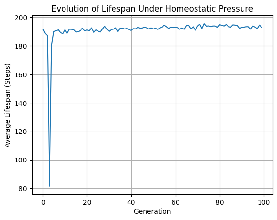

# Spatial model history

## Theoretical Foundations
1. **Self-maintenance and control:** Self-maintenance motivates the model. The implemented controller maps exact vent offsets and current energy directly to movement. Learning a predictive model is a future research question.
2. **Heritable controller parameters:** Offspring inherit six movement weights with mutation. The baseline experiment saves these weights and founder IDs at epoch boundaries.

## Simulation Mechanics
* **Metabolic Cost:** Every simulation step costs `0.5` energy units.
* **Homeostasis:** If internal energy drops to `0`, the agent is removed from the population (death).
* **Mitosis:** If an agent reaches `200` units of energy, it reproduces, passing mutated controller weights to its offspring.
* **Carrying Capacity:** The environment supports a maximum of 500 agents, retaining the highest-energy cells whenever the cap is exceeded.

## Experimental Progression & Tuning

* **v1.0 — Initial extinction:** Retrospective account of extinction at generation 0; original run records unavailable.
* **v1.1 — Unbounded population growth:** Retrospective account of more than 200,000 agents by generation 1; original run records unavailable.
* **v1.2 — Population cap:** The surviving implementation retains the 500 highest-energy agents when the cap is exceeded. Navigation is evaluated separately.

## Recorded outcome
The historical plot tracks average age among surviving cells at each epoch boundary. For the frozen-controller vent-reaching experiment and the subsequent local-sensing and inherited-memory studies, see [the research programme](RESEARCH.md).

*Simulation built in Python/NumPy.*
