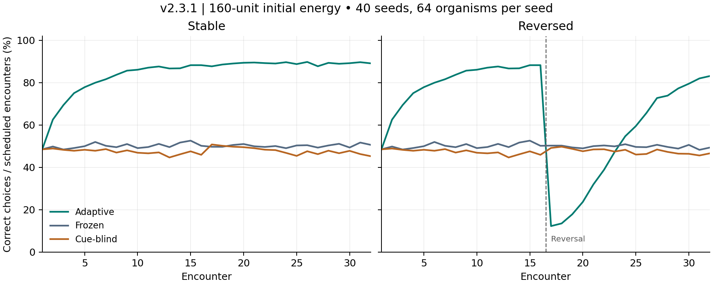
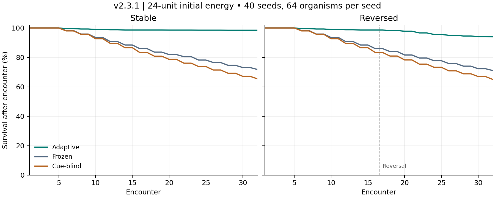

# v2.3.1 — Lifetime learning: results and independent audit

Run date: 26 November 2026. Methodology checkpoint: `091731949bb5ad5eac74c0257d05a98c8d1a4786` (original checkpoint; see [technical provenance](../../docs/PUBLIC_TECHNICAL_PROVENANCE.md)). See [protocol](PROTOCOL.md), [implementation](IMPLEMENTATION.md), and [locked analysis](ANALYSIS.md).

## Primary outcome

Stable environment, initial energy 160, encounters 9–16: adaptive genuine-cue organisms selected the higher-probability patch on 87.05% of scheduled encounters vs 50.62% for frozen controls. The paired seed-level mean difference was **+36.43 percentage points (95% paired t CI +35.61 to +37.25)**, satisfying the predeclared criterion. All 40 seed contrasts were positive (range +29.69 to +42.58 pp, descriptive post-run audit). The independent replicate unit is the seed, not the organism or encounter.

## Exploratory outcomes

At 160 energy, adaptive genuine-cue learners' late acquisition was 87.05% vs 46.63% for cue-blind learners (+40.42 pp). In the reversed world, early post-reversal accuracy (17–20) was 16.86%, rising to 74.20% (25–32), +57.35 pp. Recovery remained 14.85 pp below stable late performance. This is an effect of the supplied learning mechanism under a designed change in contingencies.

| World (24 energy) | Adaptive survival | Frozen survival | Cue-blind survival | Adaptive vs frozen difference |
| --- | ---: | ---: | ---: | ---: |
| Stable | 98.48% | 71.80% | 65.43% | +26.68 pp |
| Reversed | 93.98% | 71.05% | 65.00% | +22.93 pp |

Mean final energy including deaths as zero: stable 85.00 / 24.225 / 20.366 units; reversed 52.006 / 24.078 / 20.084, respectively (adaptive / frozen / cue-blind). High-energy survival was 100% as designed. Secondary comparisons are descriptive, not independent confirmatory tests.

## Data and audit

The original ZIP SHA-256 is `500df8100610cb07c85e94cf78d11d844f3206584663aee3cbd067b03cc4992e`. The [original ZIP](results/original_run.zip) is retained byte-for-byte, including all 520 raw archives, and its CSV/JSON summaries are also available in the [results folder](results/); the [audit report](audit.json) and [audit code](audit_results.py) were produced after execution. Audit using Python 3.13.5 / NumPy 2.3.5 independently reconstructed the scalar encounter dynamics from saved random schedules, compared decisions, reward, movement, death, energy, memory and pairing against the 480 condition archives, validated 40 schedules, and recomputed 257,048 numerical values in the summary, seed, contrast, trial and death tables; maximum table difference zero at the reported precision (tolerance 1e-12). State comparisons use absolute tolerance 1e-15; discrete encounter records are exact. It inspected 30,720 condition-assigned trajectories, 983,040 scheduled encounters, 935,536 actual decisions and 3,437 deaths. This is a computational audit of the recorded schedules, not a fresh-seed replication or independent test of the model's biological validity. RNG generation itself was not independently replayed.

Original run: Python 3.9.6, NumPy 2.0.2, macOS ARM64, as recorded in [manifest](results/manifest.json). Six local implementation files matched both the original manifest SHA-256 and the corresponding published Git blob identifiers during the audit; the installation script checks all seven source hashes on the author's machine. The two figures are descriptive visualisations generated from the saved trial aggregates, not additional experiments. Reproduce the audit with `python audit_results.py results/original_run.zip`; reproduce figures with `python plot_results.py results/trial_aggregate.csv NEW_EXTERNAL_DIR`.

## Interpretation and limitations

The designed learning mechanism improves correct choices in this particular environment. Reversal and mortality results suggest context-dependent utility and energetic benefit. The controller's movement and learning rules are supplied, cognitive processing is not charged extra, resources do not deplete, and no evolution or reproduction occurs. This experiment cannot establish evolved learning, general intelligence, consciousness or applicability to real-world training. The sample size was not based on a formal power calculation. The 40-seed primary analysis was fixed before execution; additional comparisons and figures must remain exploratory. See [future directions](../../docs/FUTURE_DIRECTIONS.md).
